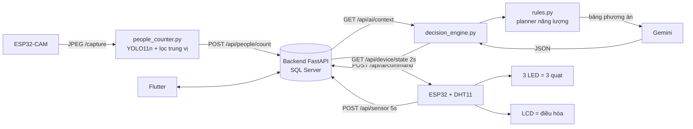

# Tối ưu hóa hệ thống điều khiển quạt – điều hòa (AIoT Smart Room)

> Phạm vi: phần AI (`ai_service/`) — đếm người bằng YOLO, ra quyết định bằng bộ lập kế hoạch năng lượng + Gemini.
> Áp dụng cho backend **v4** (3 quạt độc lập `fan1/fan2/fan3` + 1 điều hòa).
> Cập nhật: 20/11/2026.

---

## 1. Mục tiêu

| Mục tiêu | Chỉ số đo |
|---|---|
| **Tiện nghi**: người trong phòng không thấy nóng | Nhiệt độ cảm nhận ≤ 26°C (chỉnh được) |
| **Tiết kiệm điện**: dùng thiết bị rẻ nhất đủ mát | Công suất ước tính (W), so với cách dùng "chỉ bật điều hòa 25°C" |
| **Ổn định**: thiết bị không bật/tắt liên tục, bảo vệ máy nén | Số lần đổi trạng thái / giờ |
| **Tiết kiệm tài nguyên AI**: ít gọi LLM, chịu được lỗi | Số lần gọi Gemini / giờ, tỉ lệ dùng phương án dự phòng |

Câu hỏi trọng tâm: **khi nào chỉ bật quạt, khi nào chỉ bật điều hòa, khi nào kết hợp cả hai?**

---

## 2. Kiến trúc và luồng dữ liệu

`ai_service` chạy riêng, chỉ giao tiếp qua API — không cần biết IP của ESP32, có thể chạy ở máy khác backend.

---

## 3. Tối ưu chức năng đếm người (YOLO)

| Kỹ thuật | Vấn đề giải quyết | Thông số |
|---|---|---|
| Model nano `yolo11n.pt`, chỉ lớp `person` | Chạy được trên CPU laptop | Đo thực tế bằng webcam: **35–65 ms/khung** (khung đầu ~4.4 s do nạp model) |
| Nạp model **một lần** | Bản cũ `yolo_service.py` nạp lại model mỗi vòng | — |
| **Lọc trung vị trượt** 5 khung | YOLO thỉnh thoảng sót người → số người nhảy 1→0→1 → thiết bị bật/tắt vô lý | `SMOOTH_WINDOW=5`, chu kỳ 2 s → phản ứng chậm ~6 s |
| Chỉ gửi khi số người **thay đổi** + heartbeat 10 s | Giảm ghi DB, vẫn giữ `people_updated_at` mới | `PEOPLE_HEARTBEAT_SECONDS=10` |
| Camera lỗi → **không gửi số cũ**, giãn chu kỳ thử lại | Tránh quyết định dựa trên dữ liệu sai | Dữ liệu cũ hơn 60 s bị coi là "không rõ" |

Ví dụ thật từ log: `thô=0 → làm mượt=1` — một khung bị sót được lọc bỏ, số người gửi lên vẫn đúng.

---

## 4. Bài toán tối ưu năng lượng

### 4.1. Phát biểu

> **Chọn** tập quạt bật `F ⊆ {1,2,3}`, điều hòa bật/tắt, nhiệt độ đặt `Tset`
> **sao cho** nhiệt độ cảm nhận ≤ `T_comfort`
> **và** tổng công suất `P = Σ P_quạt(F) + P_AC(Tset)` **nhỏ nhất**.

Không gian nghiệm rất nhỏ (tối đa 4 mức số quạt × 2 trạng thái AC = 8 phương án, mỗi phương án có AC chọn sẵn
`Tset` cao nhất còn đạt tiện nghi) nên **duyệt hết** cho kết quả tối ưu chính xác (~0.05 ms/lần).

### 4.2. Mô hình

| Thành phần | Công thức / mặc định | Cơ sở |
|---|---|---|
| Cảm nhận khi **không** AC | `T + phạt_ẩm + phạt_đông − hiệu_ứng_quạt` | |
| Cảm nhận khi **có** AC | `Tset + phạt_đông − hiệu_ứng_quạt` | AC hút ẩm nên bỏ phạt ẩm |
| Phạt độ ẩm | `0.075 × (RH − 60)` khi RH > 60%, tối đa +1.9°C | Ẩm → mồ hôi khó bay hơi → thấy oi |
| Phạt đông người | `0.25 × (N − 2)` °C, tối đa +1.5°C | Mỗi người toả ~70–100 W nhiệt |
| Hiệu ứng làm mát của quạt | 1/2/3 quạt = 1.5 / 2.5 / 3.0°C; ×0.75 khi RH ≥ 70%, ×0.5 khi RH ≥ 80% | ASHRAE 55: gió bù tối đa ~3°C; gió kém hiệu quả khi ẩm |
| Công suất quạt | 45 W/quạt (từng quạt chỉnh riêng) | Quạt đứng/bàn 35–60 W, trần 60–80 W |
| Công suất AC | `P_AC × (1 − 0.06 × (Tset − 24))`, `P_AC` = 900 W | Máy ~1 HP; khuyến nghị tiết kiệm điện thường nêu 3–10%/°C |
| Giới hạn đặt | 20 ≤ Tset ≤ 28°C; ≤ 27°C khi RH ≥ 80% | Rất ẩm thì không đặt quá cao để AC còn hút ẩm |

Mọi hệ số đều là **ước lượng có thể chỉnh** (xem mục 7, 9).

### 4.3. Ba vùng hoạt động

Đây là **kết quả** của bài toán tối ưu, không phải luật viết tay:

| Vùng | Khi nào | Vì sao tiết kiệm |
|---|---|---|
| **Chỉ quạt** | Mức "thiếu tiện nghi" ≤ hiệu ứng tối đa của quạt | Quạt ~45 W ≈ 5% điện của AC → dùng ít quạt (và quạt rẻ) nhất đủ mát |
| **Kết hợp** | Quạt không đủ (nóng hơn, ẩm vừa, đông người) | Mỗi quạt (45 W) cho phép nâng `Tset` 1–1.5°C (≈ 55–80 W điện AC) → AC 27–28°C + quạt rẻ hơn AC một mình |
| **Chỉ điều hòa** | Rất ẩm (RH ≥ 80%) mà quạt không đủ; hoặc AC rất tiết kiệm (inverter ~300 W); hoặc không có quạt | Gió quạt chỉ còn ½ hiệu quả → không bù được điện quạt; AC vừa làm mát vừa hút ẩm |

### 4.4. Kết quả tính bằng planner (phòng đang tắt hết, trạng thái ổn định)

So sánh với cách dùng "truyền thống": thấy nóng là bật **chỉ điều hòa 25°C** (846 W).

**2 người**

| Nhiệt độ | RH 60% | RH 72% | RH 85% |
|---|---|---|---|
| 26°C | tắt hết — 0 W | 1 quạt — 45 W (−95%) | chỉ AC 26°C — 792 W (−6%) |
| 27°C | 1 quạt — 45 W (−95%) | 3 quạt — 135 W (−84%) | chỉ AC 26°C — 792 W (−6%) |
| 28°C | 2 quạt — 90 W (−89%) | 1 quạt + AC 27°C — 783 W (−7%) | chỉ AC 26°C — 792 W (−6%) |
| 29°C | 3 quạt — 135 W (−84%) | 1 quạt + AC 27°C — 783 W (−7%) | chỉ AC 26°C — 792 W (−6%) |
| 30–32°C | 2 quạt + AC 28°C — 774 W (−9%) | 1 quạt + AC 27°C — 783 W (−7%) | chỉ AC 26°C — 792 W (−6%) |

**5 người**

| Nhiệt độ | RH 60% | RH 72% | RH 85% |
|---|---|---|---|
| 26°C | 1 quạt — 45 W | 2 quạt — 90 W | 1 quạt + AC 26°C — 837 W |
| 27°C | 2 quạt — 90 W | 2 quạt + AC 27°C — 828 W | 1 quạt + AC 26°C — 837 W |
| 28°C | 3 quạt — 135 W | 2 quạt + AC 27°C — 828 W | 1 quạt + AC 26°C — 837 W |
| 29–32°C | 3 quạt + AC 28°C — 819 W | 2 quạt + AC 27°C — 828 W | 1 quạt + AC 26°C — 837 W |

**Nhận xét**

- Đòn bẩy tiết kiệm lớn nhất là **vùng chỉ quạt** (giảm 84–95%): hệ thống trì hoãn bật AC tới khi quạt thật sự không đủ.
- Khi buộc phải bật AC, kết hợp quạt + đặt cao chỉ giảm thêm **2–9%** theo mô hình — có ích nhưng nhỏ.
- Công suất AC do người dùng nhập ảnh hưởng trực tiếp: ở 30°C/60%, AC 2000 W → kết hợp quạt; AC inverter ~300 W → chỉ AC rẻ nhất.

---

## 5. Ràng buộc vận hành (để chạy thật ổn định)

| Quy tắc | Vấn đề | Mặc định |
|---|---|---|
| **Biên trễ**: phương án làm phòng "ấm hơn" hiện tại phải mát hơn ngưỡng thêm 0.5°C | DHT11 sai số ±2°C, ±5% → dao động quanh ngưỡng gây bật/tắt liên tục | `HYSTERESIS=0.5` |
| **Điều kiện "tự nhiên"**: nhớ nhiệt độ + độ ẩm lúc **trước khi bật AC** để đánh giá có tắt AC được không | Khi AC chạy, số đo đã bị AC kéo xuống → tưởng mát → tắt AC → nóng lại → bật AC (vòng lặp) | Hết hạn sau 30 phút; không biết thì chỉ tắt AC khi phòng mát hơn Tset ≥ 1°C |
| **Bảo vệ máy nén** | Bật/tắt máy nén liên tục hại máy, tốn điện khởi động | AC bật ≥ 10 phút mới tắt, tắt ≥ 5 phút mới bật lại (lúc chờ thì bật hết quạt) |
| **Làm mát nhanh** | Vừa bật AC, phòng còn nóng | Phòng nóng hơn Tset ≥ 2°C → bật hết quạt (trừ khi RH ≥ 80%) |
| **Phòng trống** | Người ra ngoài một lát rồi quay lại | Tắt quạt ngay; AC giữ 28°C thêm 3 phút rồi tắt |
| **Chọn quạt cụ thể** | 3 quạt có thể khác công suất / bị hỏng | Chọn quạt tổng công suất nhỏ nhất, rồi ít bật/tắt nhất; quạt hỏng không bao giờ bật |

---

## 6. Vai trò của Gemini và tối ưu việc gọi LLM

**Phân vai**: planner tính toán (chính xác, giải thích được); Gemini **chọn trong bảng phương án** có kèm bối cảnh
(số người, lý do lần trước, ràng buộc máy nén) và **viết lý do tiếng Việt** cho Dashboard. Gemini không phải "đoán" từ đầu.

| Kỹ thuật | Tác dụng |
|---|---|
| Chỉ quyết định khi có **thay đổi đáng kể** (số người, ΔT ≥ 0.5°C, ΔRH ≥ 5%, thiết bị bị đổi, hết thời gian chờ phòng trống) hoặc 2 phút/lần | Không gọi lặp vô ích |
| **Bỏ qua Gemini** khi planner xác nhận trạng thái hiện tại vẫn tối ưu (đánh giá định kỳ / thay đổi nhẹ) | Khi phòng ổn định: gần 0 lần gọi/giờ |
| Hai lần gọi cách nhau ≥ 10 s; phòng trống không gọi | Vừa giới hạn gói miễn phí |
| Ép trả **JSON theo schema**, kiểm tra & kẹp giá trị | Không bao giờ gửi lệnh sai định dạng xuống backend |
| **Comfort guard**: Gemini chọn phương án nóng hơn ngưỡng > 1°C trong khi còn phương án đạt → dùng planner | LLM không làm phòng nóng |
| Đổi model khi lỗi/hết quota (429), tự bỏ tham số model không hỗ trợ; hết model → **phương án planner** | Hệ thống không phụ thuộc hoàn toàn vào LLM |

Đo thực tế (13/11, `gemini-3.5-flash-lite`): độ trễ **1.2–1.8 s**/lần gọi.
`ai_reason` có tiền tố `[Gemini]` / `[Luật dự phòng]` / `[Tự động]` và công suất ước tính, ví dụ:
`[Gemini] 3 người, 30.5°C, ẩm 72% khá oi → điều hòa 28°C kèm 3 quạt để đặt nhiệt độ cao, tiết kiệm điện. (~819 W)`.

---

## 7. Hồ sơ thiết bị — sẵn sàng cho người dùng tự nhập

Các thông số phụ thuộc phòng được tách vào `device_profile.py`, có mặc định nên chạy ngay:

| Trường | Mặc định | Khoảng hợp lệ |
|---|---|---|
| `fan_power_w` (từng quạt) | 45, 45, 45 W | 5–300 W |
| `fans_available` | cả 3 dùng được | — |
| `ac_available` | có | — |
| `ac_power_w` | 900 W | 200–4000 W |
| `comfort_max_temp` | 26°C | 23–29°C |
| `ac_set_min` / `ac_set_max` | 20 / 28°C | 16–32°C |

Thứ tự ưu tiên: **mặc định → `.env` → backend `GET /api/ai/context` khối `config`** (ghi đè từng trường).
Giá trị sai bị bỏ qua kèm cảnh báo; đổi cấu hình áp dụng ngay ở vòng kế tiếp. Mô tả đầy đủ cho form nhập:
`ai_service/docs/device_config_schema.json`. Kế hoạch làm phía backend/Flutter: `docs/KE_HOACH_CAP_NHAT_BACKEND_FRONTEND.md`.

Tham số **kỹ thuật** của mô hình (hiệu ứng quạt, biên trễ, thời gian máy nén…) vẫn để trong `.env` của `ai_service`.

---

## 8. Đo lường và đánh giá

Mỗi quyết định ghi một dòng vào `ai_service/logs/decisions.jsonl`:

| Trường | Dùng để |
|---|---|
| `trigger`, `people`, `temperature`, `humidity`, `before` | Biết vì sao và trong bối cảnh nào hệ thống quyết định |
| `planner` (phương án đề xuất, công suất) | So sánh Gemini với planner |
| `decision` (`source`, `mode_label`, `fans`, `ac_on`, `ac_temp`, `est_power_w`) | Thống kê tỉ lệ chỉ quạt / kết hợp / chỉ AC |
| `baseline_ac_only_w` | Công suất nếu "chỉ bật AC 25°C" → tính % tiết kiệm |
| `model`, `llm_latency_s`, `llm_error` | Độ trễ và độ tin cậy của Gemini |
| `profile` | Hồ sơ thiết bị đang dùng |

**Chỉ số đề xuất cho báo cáo**

- Điện năng ước tính: `E = Σ P_i × Δt_i` (P của quyết định i, Δt đến quyết định kế tiếp); so với `E_baseline` cùng cách tính.
- Tiết kiệm (%) = `1 − E / E_baseline`.
- Tỉ lệ thời gian theo vùng: chỉ quạt / kết hợp / chỉ AC / tắt hết.
- Số lần AC đổi bật/tắt mỗi giờ (ổn định).
- Số lần gọi Gemini mỗi giờ, độ trễ trung bình, tỉ lệ `[Luật dự phòng]`.
- Số phút "không đạt tiện nghi" (cảm nhận > ngưỡng) — kiểm tra bằng cách hỏi người trong phòng hoặc so với cảm biến.

**Kịch bản thử nghiệm / demo**: `ai_service/simulate.py` cho nhiệt độ, độ ẩm, số người thay đổi theo kịch bản
(`full`, `chi-quat`, `ket-hop`, `chi-dieu-hoa`, `phong-trong` hoặc file JSON tự tạo), chấm ✓/✗ từng bước so với chế độ
mong đợi. Chạy được offline (tập dượt, lấy số liệu) hoặc với backend thật (mode `override`: gửi lệnh thật nên LED/LCD,
Dashboard đổi theo; lý do có tiền tố `[Mô phỏng]`). Thời gian máy nén/phòng trống được rút gọn cho demo.
Kiểm thử tự động: `ai_service/tests/e2e_scenario.py`.

---

## 9. Giới hạn và hướng phát triển

**Giới hạn**

- Công suất là **ước tính** từ nhãn thiết bị và hệ số 6%/°C; chưa đo thực tế.
- Mô hình trạng thái ổn định: giả định AC luôn đạt được `Tset`, chưa tính công suất làm lạnh tối đa hay nhiệt độ ngoài trời.
- Hiệu ứng làm mát của quạt tính theo **số** quạt, chưa tính vị trí người so với từng quạt.
- DHT11 sai số lớn (±2°C, ±5% RH) — biên trễ giảm ảnh hưởng nhưng không loại bỏ hoàn toàn.

**Hướng phát triển**

1. **Người dùng tự nhập hồ sơ thiết bị** trên app (đã sẵn sàng phía AI, xem kế hoạch backend/frontend).
2. **Chọn quạt theo vị trí người**: dùng toạ độ bounding box YOLO, chia khung hình thành vùng gần quạt 1/2/3.
3. **Học sở thích**: khi người dùng chuyển MANUAL và chỉnh lại, ghi nhận để điều chỉnh `comfort_max_temp`.
4. **Đo điện thật** bằng module đo công suất (ví dụ PZEM-004T) để hiệu chỉnh mô hình.
5. Thêm **nhiệt độ ngoài trời** (API thời tiết) để dự báo tải lạnh, bật AC sớm hơn khi trời đang nóng lên.
6. Thay polling bằng **MQTT/WebSocket** để ESP32 và app phản hồi tức thì, giảm tải backend.
